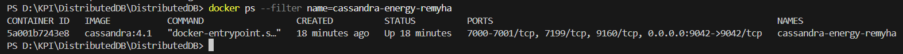
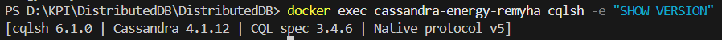
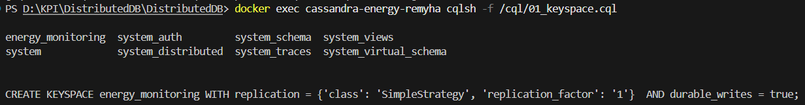
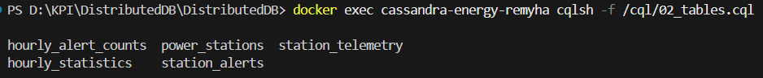
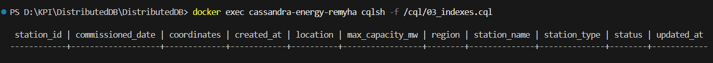
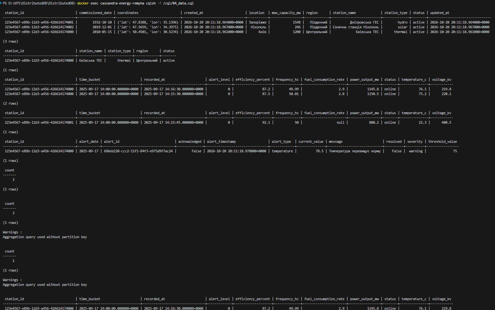
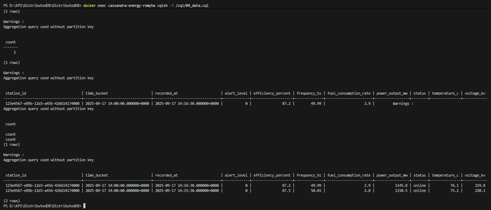
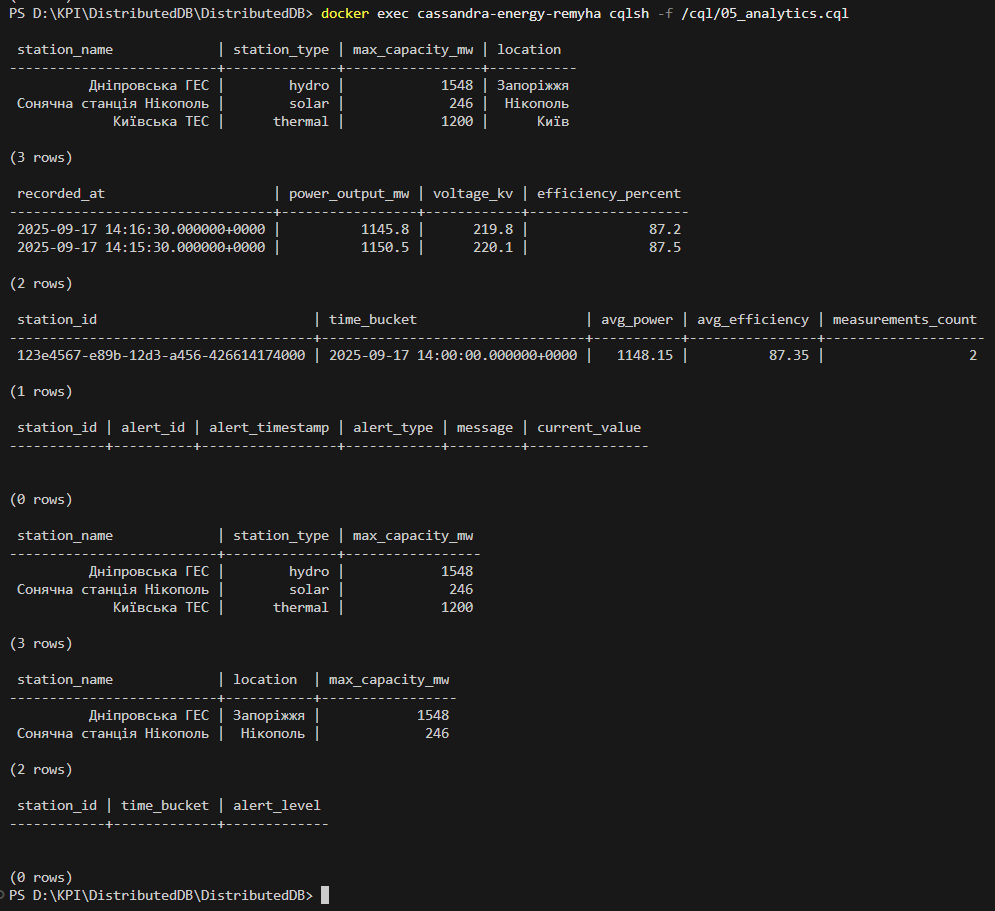
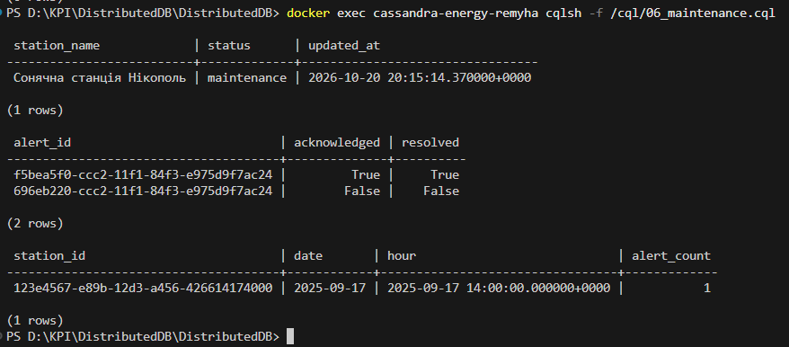
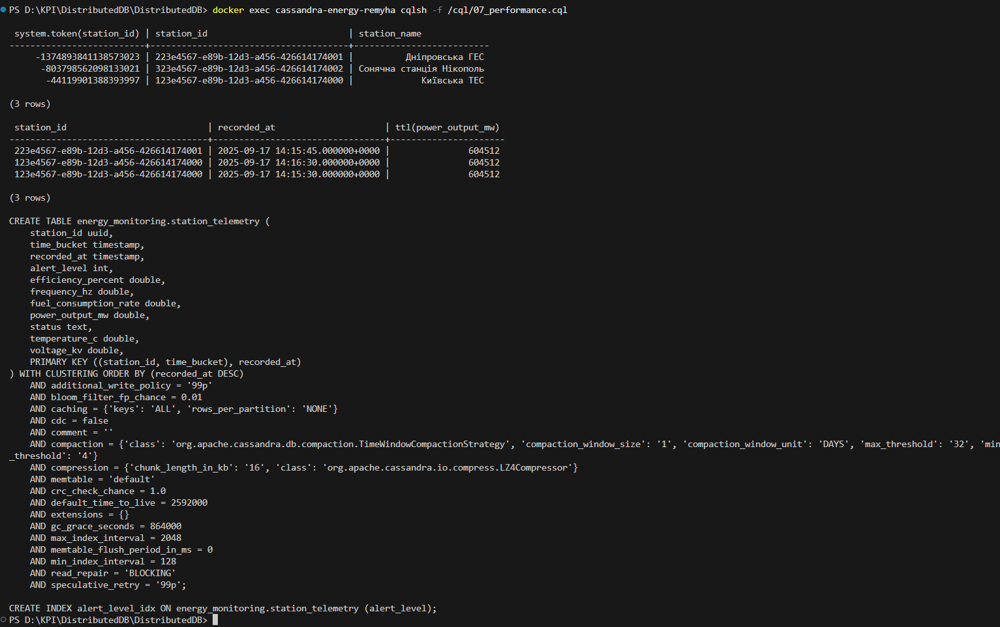

# Практична робота: Основи Apache Cassandra. Енергетична система

**Студент:** Ремига Богдан Сергійович  
**Дисципліна:** Розподілені бази даних  
**Група:** ТР-61мп

## Тема

Основи Apache Cassandra: проєктування моделі даних та робота з CQL на прикладі системи моніторингу електростанцій.

## Мета

- Ознайомитися з архітектурою Apache Cassandra (keyspace, partition key, clustering key, реплікація).
- Навчитися створювати keyspace, таблиці та вторинні індекси за допомогою CQL.
- Відпрацювати вставку, вибірку й оновлення даних, використання TTL і COUNTER.
- Перевірити розподіл даних і параметри таблиць.

## Лістинг

CQL-скрипти (виконуються по порядку):

- [`cql/01_keyspace.cql`](cql/01_keyspace.cql)
- [`cql/02_tables.cql`](cql/02_tables.cql)
- [`cql/03_indexes.cql`](cql/03_indexes.cql)
- [`cql/04_data.cql`](cql/04_data.cql)
- [`cql/05_analytics.cql`](cql/05_analytics.cql)
- [`cql/06_maintenance.cql`](cql/06_maintenance.cql)
- [`cql/07_performance.cql`](cql/07_performance.cql)

Допоміжні файли: [`docker-compose.yml`](docker-compose.yml)

Репозиторій: https://github.com/Mast0/DistributedDB

## Середовище

| Компонент | Версія |
|---|---|
| ОС | Windows 11 |
| Apache Cassandra | 4.1 (офіційний образ `cassandra:4.1`) |
| Запуск | Docker 28.0.1, Docker Compose |
| Клієнт | `cqlsh` усередині контейнера, порт 9042 |

Cassandra 4.x не має підтримки Windows, а на машині встановлена Java 25, тому замість розпакування архіву в `C:\cassandra` вузол запущено у Docker-контейнері. Кластер складається з одного вузла.

## Хід роботи

### Крок 1. Встановлення та запуск Cassandra

Запуск вузла командою `docker compose up -d` і перевірка контейнера:

Версії Cassandra, CQL та протоколу:

### Крок 2. Створення KEYSPACE

Створено `energy_monitoring` зі стратегією `SimpleStrategy` та `replication_factor = 1`:

### Крок 3. Створення таблиць

Створено п'ять таблиць: `power_stations`, `station_telemetry`, `station_alerts`, `hourly_alert_counts`, `hourly_statistics`:

### Крок 4. Створення індексів

Вторинні індекси за `station_type`, `region`, `status` для таблиці `power_stations`, `alert_level` для `station_telemetry` та `severity` для `station_alerts`:

### Крок 5. Додавання тестових даних та перевірка

Додано три станції, три записи телеметрії та одне попередження, після чого виконано перевірочні запити:

### Крок 6. Запити для аналітики

Вибірка активних станцій, останніх показників, середніх значень за годину, критичних попереджень, станцій регіону та записів з `alert_level > 0`:

### Крок 7. Операції обслуговування

Оновлення статусу станції, спроба закриття попередження, зміна параметрів таблиці телеметрії та інкремент лічильника:

Запит `UPDATE ... alert_id = now()` не змінює існуюче попередження: `now()` генерує новий TIMEUUID, тому в таблиці з'являється додатковий рядок з `acknowledged = true`, а початкове попередження залишається з `False`. Для реального закриття потрібно передати точний `alert_id`, отриманий через `SELECT`.

### Крок 8. Перевірка продуктивності

Токени розподілу, час життя записів та повний опис таблиці `station_telemetry`:

`DESCRIBE TABLE` показує вже оновлені параметри з кроку 7: `TimeWindowCompactionStrategy` і `default_time_to_live = 2592000` замість значень за замовчуванням.

## Висновок

Запущено Apache Cassandra 4.1 у Docker, створено keyspace `energy_monitoring`, п'ять таблиць із різними схемами ключів та вторинні індекси. Виконано вставку, вибірку й оновлення даних телеметрії електростанцій, перевірено аналітичні запити з обмеженнями Cassandra, роботу лічильника та параметрів TWCS і TTL. Також переглянуто токени партицій та конфігурацію таблиці.
